# dots: adoption and the Rust rewrite — dependencies

Generated snapshot from `plan/plan.json`; edit the source and regenerate.

Structural dependency chain: K-01 → K-02 → S-01 → S-02 → R-01 → Q-01 → P-02 → P-04 → I-01 → D-01 → G-1 → A-04 → G-2 → A-06. Durations are incomplete; this is not a time-based critical path or schedule.

Edges: predecessor → dependent. Layers show dependency readiness, not resource availability.

## Readiness layers

- 1: K-01
- 2: K-02, A-01
- 3: S-01, T-01
- 4: S-02
- 5: R-01
- 6: Q-01, P-11, P-12
- 7: Q-02, P-01, P-02, P-03, P-06, P-07
- 8: P-04, P-05, P-08, P-09, P-10
- 9: X-01, I-01
- 10: D-01, A-05, A-02, A-03
- 11: C-01, G-1
- 12: A-04
- 13: G-2
- 14: A-06

## Predecessors and external prerequisites

- K-01 — Go-ahead to start; needs: none; external: none
- K-02 — Orchestration smoke test; needs: K-01; external: none
- A-01 — Repository metadata; needs: K-01; external: none
- S-01 — Write the contract for 1.0; needs: K-02; external: none
- T-01 — Spike: PTY, terminal handoff and signals in Rust; needs: K-02; external: none
- S-02 — Architecture note; needs: S-01, T-01; external: none
- R-01 — Cargo package, command tree, shared modules and Rust CI; needs: S-02; external: none
- Q-01 — Acceptance harness; needs: R-01; external: none
- P-11 — Supervisor and report store; needs: T-01, R-01; external: none
- P-12 — Dashboard, menu and report browser; needs: T-01, R-01; external: none
- Q-02 — CI on Fedora, Arch and Alpine, and a first-run job; needs: Q-01; external: none
- P-01 — Packages: add, remove, adopt a dotfile, GitHub release installs; needs: Q-01; external: none
- P-02 — status, plan, apply, test, the hook and command runner, recipe helpers; needs: Q-01; external: none
- P-03 — dots init does the whole first run; needs: Q-01; external: none
- P-06 — Backup, restore and history enrollment; needs: Q-01; external: none
- P-07 — Sync, receipt and publish scenarios in the harness; needs: Q-01; external: none
- P-04 — dots up; needs: P-02; external: none
- P-05 — Bootstrap, bundles, profiles and remote bootstrap; needs: P-02; external: none
- P-08 — Sync and guarded apply; needs: P-07; external: none
- P-09 — Sync receipt and dots sync --last; needs: P-07; external: none
- P-10 — dots publish; needs: P-07; external: none
- X-01 — Move Atuin and Tailscale into Ezra's configuration and migrate it; needs: P-02, P-05; external: none
- I-01 — Integration: one binary, end to end; needs: P-01, P-03, P-04, P-05, P-06, P-08, P-09, P-10, P-11, P-12, Q-02; external: none
- D-01 — Delete the current implementation and package the Rust binary; needs: I-01; external: none
- A-05 — Reference docs, the agent skill and REVIEW.md; needs: I-01; external: none
- A-02 — Rewrite the README; needs: I-01; external: none
- A-03 — Record the demo; needs: I-01; external: none
- C-01 — Distribution; needs: D-01; external: Ezra provides a crates.io token and a token for the tap repository
- G-1 — Cutover: tag the release candidate and switch Ezra's machines; needs: D-01, X-01, A-05; external: none
- A-04 — Template configuration repository; needs: G-1; external: none
- G-2 — Release 1.0.0; needs: G-1, A-02, A-03, A-04, C-01; external: Ezra has used the release candidate for a week: daily sync on two machines and one restore, with no recovery step
- A-06 — Listings; needs: A-01, G-2; external: none

## Static diagram

```mermaid
flowchart TD
  n0["K-01 Go-ahead to start"]
  n1["K-02 Orchestration smoke test"]
  n2["A-01 Repository metadata"]
  n3["S-01 Write the contract for 1.0"]
  n4["T-01 Spike: PTY, terminal handoff and signals in Rust"]
  n5["S-02 Architecture note"]
  n6["R-01 Cargo package, command tree, shared modules and Rust CI"]
  n7["Q-01 Acceptance harness"]
  n8["P-11 Supervisor and report store"]
  n9["P-12 Dashboard, menu and report browser"]
  n10["Q-02 CI on Fedora, Arch and Alpine, and a first-run job"]
  n11["P-01 Packages: add, remove, adopt a dotfile, GitHub release installs"]
  n12["P-02 status, plan, apply, test, the hook and command runner, recipe helpers"]
  n13["P-03 dots init does the whole first run"]
  n14["P-06 Backup, restore and history enrollment"]
  n15["P-07 Sync, receipt and publish scenarios in the harness"]
  n16["P-04 dots up"]
  n17["P-05 Bootstrap, bundles, profiles and remote bootstrap"]
  n18["P-08 Sync and guarded apply"]
  n19["P-09 Sync receipt and dots sync --last"]
  n20["P-10 dots publish"]
  n21["X-01 Move Atuin and Tailscale into Ezra&#x27;s configuration and migrate it"]
  n22["I-01 Integration: one binary, end to end"]
  n23["D-01 Delete the current implementation and package the Rust binary"]
  n24["A-05 Reference docs, the agent skill and REVIEW.md"]
  n25["A-02 Rewrite the README"]
  n26["A-03 Record the demo"]
  n27["C-01 Distribution"]
  n28["G-1 Cutover: tag the release candidate and switch Ezra&#x27;s machines"]
  n29["A-04 Template configuration repository"]
  n30["G-2 Release 1.0.0"]
  n31["A-06 Listings"]
  n0 --> n1
  n0 --> n2
  n1 --> n3
  n1 --> n4
  n3 --> n5
  n4 --> n5
  n5 --> n6
  n6 --> n7
  n4 --> n8
  n6 --> n8
  n4 --> n9
  n6 --> n9
  n7 --> n10
  n7 --> n11
  n7 --> n12
  n7 --> n13
  n7 --> n14
  n7 --> n15
  n12 --> n16
  n12 --> n17
  n15 --> n18
  n15 --> n19
  n15 --> n20
  n12 --> n21
  n17 --> n21
  n11 --> n22
  n13 --> n22
  n16 --> n22
  n17 --> n22
  n14 --> n22
  n18 --> n22
  n19 --> n22
  n20 --> n22
  n8 --> n22
  n9 --> n22
  n10 --> n22
  n22 --> n23
  n22 --> n24
  n22 --> n25
  n22 --> n26
  n23 --> n27
  n23 --> n28
  n21 --> n28
  n24 --> n28
  n28 --> n29
  n28 --> n30
  n25 --> n30
  n26 --> n30
  n29 --> n30
  n27 --> n30
  n2 --> n31
  n30 --> n31
```

